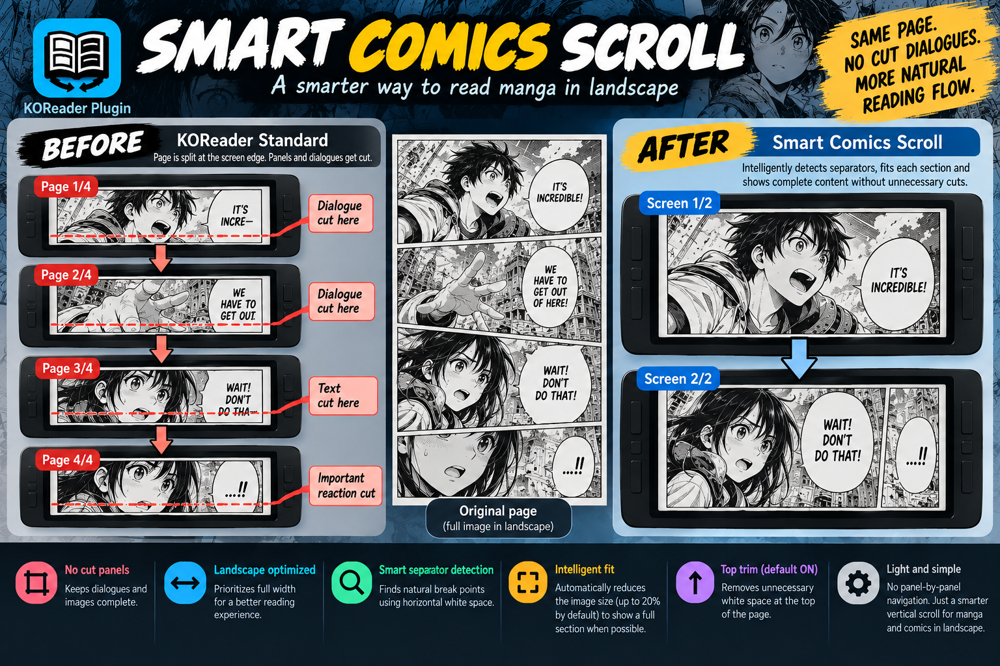

# Smart Comics Scroll

**v0.1.0-beta** · Community plugin for [KOReader](https://github.com/koreader/koreader)

Read image-based comics in **landscape orientation** with full-width rendering and screen-by-screen navigation that looks for horizontal white/black separators. Unlike panel-by-panel readers, Smart Comics Scroll does not attempt to detect individual panels.

## Inspiration and credits

The idea for **Smart Comics Scroll** was inspired by a thoughtful comment from **Jellby** on the MobileRead forums:

**[Jellby's original post — with two illustrative mock-up images](https://www.mobileread.com/forums/showpost.php?p=4575952&postcount=11)**

In that post, Jellby shared **two example images** to explain a more natural way to read comics: keeping the surrounding page visible instead of cropping to a single panel, and using panel boundaries to guide screen-by-screen reading so panels are not awkwardly cut off. Those examples helped inspire this project. Thank you, Jellby, for the idea and clear illustrations!

Smart Comics Scroll is also **partly derived from [Smart Webtoon Scroll](https://github.com/QQRush/smart-webtoon-scroll.koplugin)**. It reuses and adapts parts of that project's approach and code for separator-aware navigation, while focusing on **traditional comics and manga in landscape mode**, rather than long vertical webtoons. Both projects are developed by [QQRush](https://github.com/QQRush).

The two original mock-up images remain available in the linked MobileRead post, with credit to their author.

### Comic artwork credits

The comic artwork shown in the demonstration is from **[Pepper&Carrot — Episode 39: The Tavern](https://www.peppercarrot.com/)**, created by **[David Revoy](https://www.davidrevoy.com/)** (art and story). Original comic and author: [peppercarrot.com](https://www.peppercarrot.com/). Artwork attribution: © David Revoy; see the [official credits and licensing information](https://www.peppercarrot.com/en/about/index.html). The comic is not included in the plugin distribution.

## Demo video

[Watch the demonstration on YouTube](https://youtu.be/EC0JDg7Stds).

## Features

- Full-width rendering with conservative removal of white side margins.
- Separator-aware page turns, including thin gutters.
- FIT SCAN: may reduce the visible slice to finish at a verified separator, or fit the end of a physical image within the configured reduction limit (default **33%**).
- Optional **Auto Trim Top**, enabled by default.
- Persistent **ON/OFF** switch, also available as a KOReader gesture action.
- Two-column settings dialog; optional visual diagnostic overlay (off by default for new installations).
- Small cached separator analysis and optional render preloading.

## Installation

1. Download the release ZIP and extract it.
2. Copy the **`smartcomicsscroll.koplugin`** directory to your KOReader **`plugins/`** directory. On many Android installs this is `koreader/plugins/` in shared storage.
3. Restart KOReader.
4. Open a supported image-based comic in **landscape** and enable **Smart Comics Scroll** in the reader menu.

**Landscape tip:** In KOReader, set the desired landscape rotation (90° or 270°, depending on your device) and enable **Keep current rotation across views** in the rotation menu. This keeps landscape active when opening a new manga/CBZ, including files you have never opened before. No Auto Landscape plugin patch is needed.

The plugin **does not rotate the screen automatically**. If you already used an experimental build, saved preferences (including visual debug) may carry over.

## Gestures

In KOReader's gesture settings, look for **Smart Comics: ON/OFF**. The plugin also registers **Smart Comics: next screen** and **Smart Comics: previous screen**.

## Settings

- Search range (%): how far to inspect around the target.
- Max Page-End reduction (%): maximum permitted shrinking for fit-to-height.
- Auto Trim Top: remove verified blank space at the beginning of a view.
- Preload pages: adjust rendering work versus responsiveness.
- Visual debug: draw diagnostic lines and counters over artwork.

## Compatibility and limitations

- Intended for **KOReader in landscape** with non-reflowable, image-based comics, especially CBZ. CBR/JPG behavior may depend on the document backend and is not yet broadly verified.
- First beta tested manually on sample CBZ pages. Device/format coverage is limited; this is **not** a KOReader core feature.
- No panel recognition, no automatic rotation, no guarantee that every visual separator will be detected.
- Some pages may show blank space at their end rather than combining physical images.
- Processing high-resolution images can use noticeable memory; disable preloading if needed.

## Bug reports

Please include: KOReader version, device/OS, file type, whether landscape mode was enabled, the plugin settings, and screenshots with **Visual debug** enabled. If possible provide a copyright-safe sample image.

## Status

**Beta** — please test before relying on it for everyday reading. License: GPL-3.0 (see LICENSE).